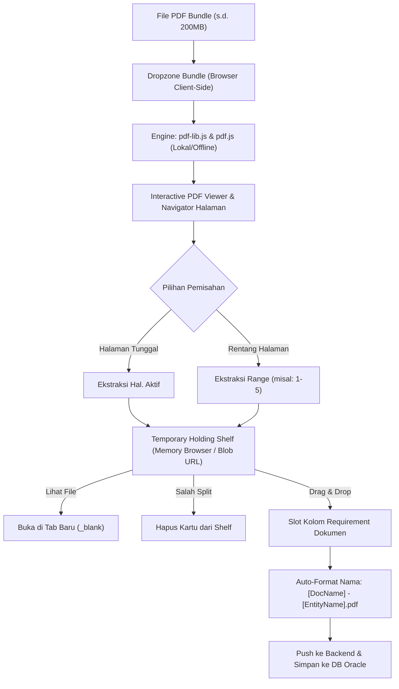

# DOKUMENTASI IMPLEMENTASI FITUR QUALITY OF LIFE (QoL)
# PDF SPLITTER & BUNDLE DOCUMENT UPLOAD

---

## 1. Latar Belakang & Tujuan

Dalam operasional harian pengajuan izin masuk (**Secure Entry System / SES**), kontraktor dan user requestor sering kali telah menyiapkan dokumen-dokumen persyaratan (seperti KTP, Kartu Keluarga, Surat Keterangan Catatan Kepolisian (SKCK), Medical Check Up (MCU), Sertifikat Vaksin, STNK, SIM, dan Uji KIR) dalam format **1 bundel file PDF besar** (seringkali mencapai puluhan hingga ratusan megabyte).

### Masalah Sebelumnya
1. Pengguna terpaksa memisahkan halaman PDF secara manual menggunakan software pihak ketiga atau layanan pemotong PDF online gratis di internet, yang menimbulkan **risiko keamanan data identitas & privasi (DevSecOps / Data Privacy Risk)**.
2. Proses pengunggahan satu per satu memakan waktu lama dan rawan kesalahan penamaan file.
3. Jika file bundle yang sangat besar dikirim mentah-mentah ke server, hal tersebut dapat membebani kapasitas memori (heap), disk storage, serta kuota database Oracle.

### Tujuan Pengembangan
Menghadirkan fitur internal **Quality of Life (QoL) PDF Splitter & Bundle Document Upload** yang terintegrasi langsung di dalam antarmuka unggah dokumen SES, dengan prinsip:
- Kemudahan pemisahan dokumen per halaman atau per rentang halaman (*range*).
- Pemrosesan mandiri di sisi peramban pengguna (*zero server memory overhead*).
- Konsep penampungan sementara (*temporary holding shelf*) dengan drag-and-drop.
- Penamaan file otomatis (*auto-formatted naming*) sesuai standar sistem.
- Keamanan database: tidak ada file sampah hasil split yang tersimpan jika tidak sengaja digunakan.

---

## 2. Arsitektur Teknis & Prinsip Desain



### 2.1. Client-Side Heavy Processing (Zero Server Memory Footprint)
- **Batasan File:** Area dropzone bundle mengizinkan file PDF hingga kapasitas **200 MB**.
- **Eksekusi:** Seluruh proses pembacaan file, render halaman (thumbnail & canvas), dan ekstraksi potongan PDF dijalankan 100% pada sisi peramban klien menggunakan library `pdf-lib.min.js` (v1.17.1) dan `pdf.min.js` (v3.11.174).
- **Efisiensi Server:** File berukuran 200MB **tidak pernah dikirimkan atau diproses di memori/disk server**. Potongan file yang dikirimkan ke endpoint Spring Boot (`/file/save-draft` atau form submit) hanyalah potongan kecil (biasanya 100 KB – 2 MB). Dengan demikian, limit `multipart.max-file-size` server tetap aman pada konfigurasi standar (20 MB).

### 2.2. Pencegahan Sampah Database (Zero Orphaned Files)
- Hasil pemotongan PDF ditampung dalam **Temporary Holding Shelf** dalam bentuk object memory browser (`Blob` & Object URL).
- Sebelum pengguna melakukan *drag-and-drop* ke kolom requirement dokumen, **tidak ada panggilan HTTP POST ke server** dan **tidak ada record file yang disimpan di Oracle Database**.
- File-file potongan yang tidak digunakan akan otomatis dibersihkan saat sesi peramban selesai tanpa meninggalkan residu di database.

### 2.3. Dynamic Bundle Replacement
- Pengguna dapat mengganti file bundle yang sedang dibuka di viewer (misalnya jika dokumen yang dibutuhkan tersebar di 2 file bundle besar).
- Mengunggah/men-drop file bundle baru akan me-refresh viewer, **tanpa menghapus kartu potongan yang sebelumnya sudah berada di temporary shelf**.

---

## 3. Komponen & Aset yang Diimplementasikan

### 3.1. Pustaka Pihak Ketiga (Offline / On-Premise Compliant)
Pustaka ditempatkan secara lokal pada direktori `resources/static/vendor/` di kedua modul (`ses-app` dan `ses-ext`), memastikan kepatuhan penuh terhadap lingkungan intranet / air-gapped kilang:
- `vendor/pdf-lib/pdf-lib.min.js`
- `vendor/pdfjs/pdf.min.js`
- `vendor/pdfjs/pdf.worker.min.js`

### 3.2. Antarmuka & Gaya Visual (`pdf-splitter.css`)
File CSS terdedikasi (`ses-app/.../static/css/pdf-splitter.css` & `ses-ext/.../static/css/pdf-splitter.css`) mencakup styling:
- **Mode Switch Pill:** Tombol seleksi elegan antara *File Terpisah* vs *Bundle PDF Splitter*.
- **Glassmorphism Workbench:** Panel kerja dengan background kartu modern, border halus, dan bayangan lembut.
- **Interactive Viewer Toolbar:** Tombol zoom, input lompat halaman, pagination pill (`Page X / Total`).
- **Temporary Shelf Cards:** Kartu penampung yang mendukung interaksi HTML5 Native Drag & Drop, indikator badge halaman, tombol aksi *View in New Tab* dan *Delete*, serta status badge *Terpakai*.
- **Target Dropzone Animation:** Efek highlight garis putus-putus dan transisi warna ketika kartu hasil split di-drag di atas slot requirement.

### 3.3. Modul Interaksi JavaScript (`pdf-splitter-workbench.js`)
Class reusable `PdfSplitterWorkbench` dirancang agar dapat di-mount pada sembarang kontainer HTML dengan konfigurasi dinamis:
```javascript
new PdfSplitterWorkbench({
    containerId: 'pdfSplitterContainer',
    maxFileSizeMb: 200,
    onSplitCreated: function(item) { /* Hook saat potongan baru dibuat */ },
    onItemRemoved: function(itemId) { /* Hook saat kartu dihapus */ }
});
```

---

## 4. Cakupan Halaman & Integrasi Form

Fitur ini diimplementasikan secara menyeluruh di 3 area utama permohonan SES:

| No | Modul | Halaman / Template | Deskripsi Integrasi |
| :--- | :--- | :--- | :--- |
| 1 | **`ses-ext`** | [`upload-docs.html`](file:///d:/GIT/Gitea/belva/ses/ses-ext/src/main/resources/templates/request/upload-docs.html) | **Halaman Unggah Dokumen Kontraktor (Public Gateway):**<br>Tampilan responsif 2-kolom. Sisi kiri adalah PDF Splitter Workbench, sisi kanan adalah daftar pekerja dan matriks slot dokumen requirement. Auto-naming: `[DocName] - [Nama Pekerja].pdf`. |
| 2 | **`ses-app`** | [`request/form.html`](file:///d:/GIT/Gitea/belva/ses/ses-app/src/main/resources/templates/request/form.html) | **Formulir Permohonan Izin Masuk Pekerja (Internal App):**<br>Tersedia mode switch pada *Worker Document Modal*. Mendukung drag-and-drop langsung ke slot requirement pekerja dengan format nama `[DocName] - [Nama Pekerja].pdf`. |
| 3 | **`ses-app`** | [`sticker/form.html`](file:///d:/GIT/Gitea/belva/ses/ses-app/src/main/resources/templates/sticker/form.html) | **Formulir Permohonan Sticker Kendaraan (Internal App):**<br>Tersedia mode switch pada *Vehicle Document Modal*. Mendukung drag-and-drop ke slot STNK, SIM, dan KIR dengan format nama otomatis `[STNK/SIM/KIR] - [No Polisi].pdf`. |

---

## 5. Alur Kerja Pengguna (User Experience Flow)

1. **Pemilihan Mode:**
   - Pengguna membuka form pengunggahan dokumen.
   - Secara default berada pada mode *File Terpisah*. Pengguna mengklik tombol toggle **Mode Bundle & PDF Splitter**.
2. **Pemilihan / Drop File Bundle:**
   - Pengguna men-drag file PDF bundle ke dropzone besar (maksimum 200MB).
   - Viewer langsung menampilkan file PDF, nama file asli, dan total halaman (misal: `1 / 47`).
3. **Pemisahan Halaman:**
   - **Opsi A (Halaman Tunggal):** Buka halaman yang diinginkan lalu klik tombol **"Ambil Hal. Ini"**.
   - **Opsi B (Rentang Halaman):** Masukkan rentang pada input (misal `1-5`), lalu klik tombol **"Pisahkan Range"**.
4. **Manajemen di Temporary Shelf:**
   - Potongan PDF langsung muncul sebagai kartu di rak penampungan sementara.
   - Pengguna dapat mengklik ikon **Mata** untuk melihat potongan file di tab baru browser (`window.open(..., '_blank')`).
   - Pengguna dapat mengklik ikon **Tong Sampah** untuk menghapus potongan jika ada kesalahan halaman.
5. **Drag & Drop ke Kolom Requirement:**
   - Pengguna men-drag kartu dari rak sementara dan men-drop-nya ke kotak requirement dokumen yang dituju.
   - Sistem secara otomatis:
     - Mengubah nama file menjadi format standar: `[Nama Dokumen] - [Nama Pekerja/No Polisi].pdf`.
     - Mengunggah file ke backend secara instan.
     - Menandai kartu di rak sementara dengan badge **Terpakai: [Nama Dokumen]**.
6. **Dynamic Replacement (Jika Diperlukan):**
   - Jika kebutuhan dokumen belum lengkap dan tersisa di file bundle kedua, pengguna dapat men-drop file bundle kedua ke area viewer. Viewer terupdate ke file baru, dan kartu di rak penampungan sebelumnya tetap utuh.

---

## 6. Standar Penamaan File Otomatis (*Auto-Naming*)

Sistem menerapkan konvensi penamaan seragam untuk memudahkan identifikasi dokumen oleh petugas pemeriksa dan keamanan kilang:

| Konteks Dokumen | Contoh Dokumen Asli | Input Target | Output Nama Otomatis |
| :--- | :--- | :--- | :--- |
| **Pekerja (External / Internal)** | Bundle_Rekrutmen_PT_XYZ.pdf | Medical Check Up / Budi Santoso | `Surat Kesehatan - Budi Santoso.pdf` |
| **Pekerja (KTP)** | Dokumen_Lengkap.pdf | KTP / Ahmad Dahlan | `KTP - Ahmad Dahlan.pdf` |
| **Kendaraan (STNK)** | Berkas_Kendaraan_Operasional.pdf | STNK / KT 1234 BZ | `STNK - KT 1234 BZ.pdf` |
| **Kendaraan (SIM)** | Scan_Driver_2026.pdf | SIM / KT 1234 BZ | `SIM - KT 1234 BZ.pdf` |
| **Kendaraan (KIR)** | Uji_Berkala_Dishub.pdf | KIR / KT 1234 BZ | `KIR - KT 1234 BZ.pdf` |

---

## 7. Verifikasi Lingkungan & Uji Coba Aplikasi

Aplikasi berjalan pada lingkungan lokal pengujian dengan konfigurasi berikut:
- **Basis Data:** Oracle 19c (`10.10.214.48:1521/ELLDEV`), skema `ses` / `ses2026`.
- **Java Runtime:** Java 8 Adoptium (`jdk-8.0.502.7-hotspot`).
- **Build Status:** Maven reactor multi-module (`ses-parent`, `ses-core`, `ses-app`, `ses-ext`) berstatus **BUILD SUCCESS**.

### Tautan Akses Langsung untuk Pengujian:

1. **SES External Gateway (`ses-ext`):**
   - **URL:** [http://localhost:8083/ses-ext/request/upload-docs?token=c1efa1eebf99eedd2295bfe1124b8d8035da84db8a498398288d8b3406deff1f](http://localhost:8083/ses-ext/request/upload-docs?token=c1efa1eebf99eedd2295bfe1124b8d8035da84db8a498398288d8b3406deff1f)
   - Tidak memerlukan autentikasi login, token permohonan nomor `REQ-2026-0082` aktif hingga 7 hari ke depan.

2. **SES Internal Application (`ses-app`):**
   - **URL:** [http://localhost:8082](http://localhost:8082)
   - **Kredensial Admin:** Username `test2`, Password `test2`
   - **Kredensial Requestor:** Username `test`, Password `test`
   - Form permohonan dapat diakses di:
     - Permohonan Izin Masuk: [http://localhost:8082/request/new](http://localhost:8082/request/new)
     - Permohonan Sticker: [http://localhost:8082/sticker/new](http://localhost:8082/sticker/new)

---

## 8. Ringkasan File Perubahan

```
ses/
├── docs/
│   └── DOKUMENTASI_FITUR_PDF_SPLITTER_BUNDLE_UPLOAD.md       <-- Dokumen ini
├── ses-app/
│   ├── src/main/resources/
│   │   ├── application-local.properties                      <-- Konfigurasi DB Oracle ELLDEV
│   │   ├── static/
│   │   │   ├── css/pdf-splitter.css                          <-- Styling komponen PDF splitter
│   │   │   ├── js/pdf-splitter-workbench.js                  <-- Controller workbench PDF splitter
│   │   │   └── vendor/
│   │   │       ├── pdf-lib/pdf-lib.min.js                    <-- Library engine ekstraksi PDF
│   │   │       └── pdfjs/                                    <-- Library rendering viewer PDF
│   │   └── templates/
│   │       ├── request/form.html                             <-- Integrasi modal pekerja
│   │       └── sticker/form.html                             <-- Integrasi modal kendaraan
├── ses-core/
│   └── src/main/java/com/badaklng/ses/file/
│       └── AppFileService.java                               <-- Refactor constructor explicit
└── ses-ext/
    ├── src/main/resources/
    │   ├── application-local.properties                      <-- Konfigurasi DB Oracle ELLDEV
    │   ├── static/
    │   │   ├── css/pdf-splitter.css                          <-- Styling komponen PDF splitter
    │   │   ├── js/pdf-splitter-workbench.js                  <-- Controller workbench PDF splitter
    │   │   └── vendor/
    │   │       ├── pdf-lib/pdf-lib.min.js
    │   │       └── pdfjs/
    │   └── templates/
    │       └── request/upload-docs.html                      <-- Integrasi halaman unggah kontraktor
```

