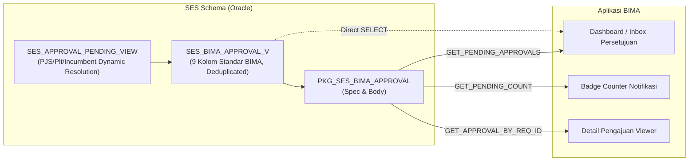

# Dokumentasi Integrasi Data Approval SES untuk Aplikasi BIMA

Dokumen ini menjelaskan antarmuka (interface) data approval sistem Secure Entry System (SES) yang disiapkan untuk dikonsumsi oleh aplikasi **BIMA (Badak Integrated Mobile Application)**.

---

## 1. Arsitektur Integrasi

Integrasi antara SES dan BIMA dilakukan pada level Oracle Database melalui dua komponen utama:
1. **Database View (`SES_BIMA_APPROVAL_V`)**: Menyajikan daftar antrean pending approval SES dalam bentuk tabel datar (*flattened view*) yang mematuhi 9 kolom standar BIMA.
2. **PL/SQL Package (`PKG_SES_BIMA_APPROVAL`)**: Menyediakan fungsi-fungsi prosedural untuk mengambil cursor pending approvals, count pending per badge karyawan (untuk badge notification counter), query detail pengajuan, dan pagination (*limit/offset*).

Integrasi ini bersifat **Read-Only**: BIMA bertindak sebagai viewer/inbox tugas persetujuan terpusat. Ketika pengguna menekan item pengajuan di BIMA, pengguna diarahkan ke antarmuka web SES untuk melakukan verifikasi mendalam dan eksekusi persetujuan.



---

## 2. Spesifikasi Kolom Data (9 Kolom Standar BIMA)

Objek View `SES_BIMA_APPROVAL_V` dan fungsi cursor pada `PKG_SES_BIMA_APPROVAL` mengembalikan data dengan skema 9 kolom berikut:

| No | Nama Kolom | Tipe Data Oracle | Nullable | Keterangan & Sumber Data SES | Contoh Nilai |
|:---|:---|:---|:---|:---|:---|
| 1 | `TO_USER` | `VARCHAR2(6)` | Ya | Nomor badge karyawan approver saat ini (diambil dari `approver_empl_id`). | `'133458'` |
| 2 | `MOD_ID` | `CHAR(3)` | Ya | Kode modul sistem SES. Bernilai tetap `'SES'`. | `'SES'` |
| 3 | `MOD_SUB_ID` | `CHAR(2)` | Ya | Kode sub-modul:<br/>- `'BD'` : Pengajuan Badge / SIM Masuk (`SES_REQUEST`)<br/>- `'ST'` : Pengajuan Sticker Kendaraan (`SES_STICKER_REQUEST`) | `'BD'` |
| 4 | `REQ_ID` | `VARCHAR2(16)` | Tidak | Nomor unik pengajuan (`REQUEST_NO`), panjang maksimal 16 karakter. | `'REQ-2026-0094'` |
| 5 | `REQ_DESC` | `VARCHAR2(408)` | Ya | Deskripsi ringkas pengajuan dengan format:<br/>`Nama Tahap - No Pengajuan - Jenis Pengajuan (Nama Pemohon)` | `'Officer / Co-Officer Approval - REQ-2026-0094 - Badge Vendor (UMAR HAKIM)'` |
| 6 | `REQ_DATE` | `DATE` | Ya | Tanggal dan jam pengajuan disubmit oleh pemohon (`req_date`). | `2026-10-14 11:39:35` |
| 7 | `REQ_BY` | `VARCHAR2(6)` | Ya | Nomor badge karyawan pemohon (`requestor_user_id` / `ru.username`). | `'136141'` |
| 8 | `APP_REMARK` | `VARCHAR2(4000)` | Ya | Catatan persetujuan. Bernilai `NULL` pada status antrean pending. | `NULL` |
| 9 | `APP_REMARK_TYPE` | `VARCHAR2(50)` | Ya | Tipe catatan aksi persetujuan. Bernilai `NULL` pada status antrean pending. | `NULL` |

---

## 3. Spesifikasi PL/SQL Package (`PKG_SES_BIMA_APPROVAL`)

### A. Fungsi `GET_PENDING_APPROVALS`
Mengambil daftar pending approval dalam bentuk `SYS_REFCURSOR`.
```sql
FUNCTION GET_PENDING_APPROVALS(
    p_to_user IN VARCHAR2 DEFAULT NULL
) RETURN SYS_REFCURSOR;
```
- **Parameter**:
  - `p_to_user` *(opsional)*: Nomor badge karyawan (6 karakter). Jika diisi, hanya mengembalikan daftar tugas pending milik approver tersebut. Jika `NULL`, mengembalikan seluruh antrean pending SES.
- **Return**: `SYS_REFCURSOR` dengan 9 kolom standar BIMA, diurutkan berdasarkan `REQ_DATE DESC`.

### B. Fungsi `GET_PENDING_COUNT`
Menghitung jumlah antrean pending approval untuk approver tertentu.
```sql
FUNCTION GET_PENDING_COUNT(
    p_to_user IN VARCHAR2
) RETURN NUMBER;
```
- **Parameter**:
  - `p_to_user`: Nomor badge karyawan approver. Jika `NULL`, mengembalikan total seluruh antrean pending.
- **Return**: `NUMBER` (jumlah pengajuan pending). Jika terjadi pengecualian/error, mengembalikan `0`.
- **Kegunaan**: Menampilkan angka counter notifikasi (badge red dot) pada menu aplikasi mobile BIMA.

### C. Fungsi `GET_APPROVAL_BY_REQ_ID`
Mengambil data approval spesifik berdasarkan nomor pengajuan.
```sql
FUNCTION GET_APPROVAL_BY_REQ_ID(
    p_req_id IN VARCHAR2
) RETURN SYS_REFCURSOR;
```
- **Parameter**:
  - `p_req_id`: Nomor pengajuan SES (misal: `'REQ-2026-0094'` atau `'STK-2026-0001'`).
- **Return**: `SYS_REFCURSOR` berisi data pengajuan tersebut.

### D. Fungsi `GET_PENDING_APPROVALS_PAGED`
Mengambil daftar pending approval dengan dukungan pagination (offset & limit).
```sql
FUNCTION GET_PENDING_APPROVALS_PAGED(
    p_to_user IN VARCHAR2 DEFAULT NULL,
    p_offset  IN NUMBER DEFAULT 0,
    p_limit   IN NUMBER DEFAULT 20
) RETURN SYS_REFCURSOR;
```
- **Parameter**:
  - `p_to_user` *(opsional)*: Nomor badge approver.
  - `p_offset`: Posisi awal data (dimulai dari `0`).
  - `p_limit`: Jumlah data maksimum yang diambil (default `20`).
- **Return**: `SYS_REFCURSOR` berisi halaman data yang diminta.

---

## 4. Contoh Penggunaan (Code Snippets)

### Contoh 1: SQL Direct Query
Aplikasi BIMA dapat melakukan query langsung ke View:
```sql
-- Mengambil seluruh pending approval untuk badge 133458
SELECT *
FROM SES.SES_BIMA_APPROVAL_V
WHERE TO_USER = '133458'
ORDER BY REQ_DATE DESC;
```

### Contoh 2: PL/SQL Block
```sql
DECLARE
    v_count NUMBER;
    v_cur   SYS_REFCURSOR;
    v_row   SES.SES_BIMA_APPROVAL_V%ROWTYPE;
BEGIN
    -- 1. Ambil jumlah pending approval
    v_count := SES.PKG_SES_BIMA_APPROVAL.GET_PENDING_COUNT('133458');
    DBMS_OUTPUT.PUT_LINE('Jumlah tugas pending: ' || v_count);

    -- 2. Ambil cursor daftar tugas
    v_cur := SES.PKG_SES_BIMA_APPROVAL.GET_PENDING_APPROVALS('133458');
    LOOP
        FETCH v_cur INTO v_row;
        EXIT WHEN v_cur%NOTFOUND;
        DBMS_OUTPUT.PUT_LINE(v_row.REQ_ID || ' : ' || v_row.REQ_DESC);
    END LOOP;
    CLOSE v_cur;
END;
/
```

### Contoh 3: Java (JDBC / Spring Data Callable)
```java
// Contoh pemanggilan GET_PENDING_COUNT menggunakan JDBC SimpleJdbcCall
SimpleJdbcCall jdbcCall = new SimpleJdbcCall(dataSource)
        .withSchemaName("SES")
        .withCatalogName("PKG_SES_BIMA_APPROVAL")
        .withFunctionName("GET_PENDING_COUNT");

SqlParameterSource in = new MapSqlParameterSource()
        .addValue("p_to_user", "133458");

Integer pendingCount = jdbcCall.executeFunction(Integer.class, in);
```

---

## 5. Deployment & Operasional

File-file instalasi tersimpan pada direktori repository:
- **Instalasi Penuh**: `sql/production/261029/INSTALL-261029.sql`
- **DDL View & Package**: `sql/production/261029/56_ses_bima_approval_pkg.sql`
- **Skrip Verifikasi**: `sql/production/261029/99_verify_bima_pkg.sql`
- **Skrip Rollback**: `sql/production/261029/56_ses_bima_approval_pkg_rollback.sql`

### Menjalankan di Production (ELLPRD):
```bash
sqlplus ses@//10.10.217.252:1521/ELLPRD @INSTALL-261029.sql
```

### Hak Akses (Grants) untuk User BIMA:
Jika aplikasi BIMA terhubung menggunakan database user/schema tersendiri (misal: `BIMA_USER`), jalankan pemberian hak akses sebagai user `SES`:
```sql
GRANT SELECT ON SES.SES_BIMA_APPROVAL_V TO BIMA_USER;
GRANT EXECUTE ON SES.PKG_SES_BIMA_APPROVAL TO BIMA_USER;

-- Opsional: Membuat Synonym agar BIMA dapat memanggil tanpa prefix skema SES
-- (Dijalankan sebagai DBA atau user BIMA):
CREATE OR REPLACE SYNONYM BIMA_USER.SES_BIMA_APPROVAL_V FOR SES.SES_BIMA_APPROVAL_V;
CREATE OR REPLACE SYNONYM BIMA_USER.PKG_SES_BIMA_APPROVAL FOR SES.PKG_SES_BIMA_APPROVAL;
```
