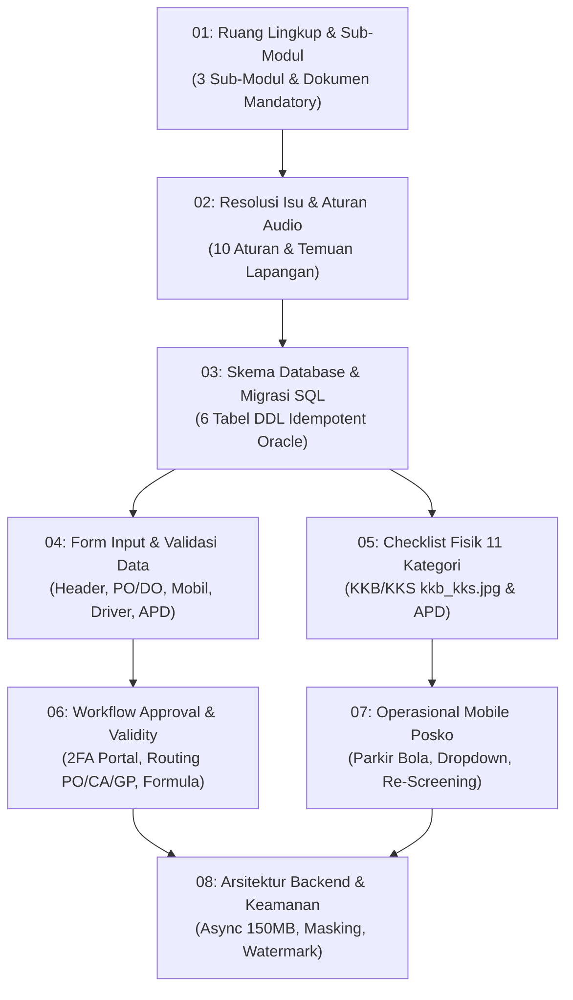

# Pipeline & Panduan Staging Pengerjaan Modul Perizinan Material SES

Dokumen ini merupakan indeks dan panduan pembagian tahapan (*staging pipeline*) untuk implementasi **Modul Perizinan Material (Izin Barang Masuk, Izin Keluar, dan Gate Pass)** pada **Secure Entry System (SES) PT Badak NGL**.

Seluruh spesifikasi dalam folder `staging/` ini mengacu secara mutlak pada dokumen master resmi:  
📄 [**`master_spesifikasi_blueprint_modul_izin_barang_masuk_ses_revisi_final_audio.md`**](../master_spesifikasi_blueprint_modul_izin_barang_masuk_ses_revisi_final_audio.md)  
*(Hasil audit silang dokumen spesifikasi terhadap bukti rekaman audio rapat teknis dan operasional lapangan).*

---

## 1. Peta Tahapan Pengerjaan (*Staging Pipeline*)

Pengerjaan modul perizinan material dibagi menjadi **8 berkas tahapan modular** yang dapat dieksekusi secara terstruktur oleh tim pengembang backend, frontend web, mobile posko, dan DBA:

| File Staging | Fokus Implementasi & Area Modul | Target Tim |
| :--- | :--- | :--- |
| [**`01-ruang-lingkup-dan-submodul.md`**](01-ruang-lingkup-dan-submodul.md) | Definisi 3 sub-modul (Izin Masuk, Izin Keluar linkage, Gate Pass), peran aktor, dan dokumen acuan wajib. | System Analyst & PM |
| [**`02-resolusi-isu-dan-aturan-audio.md`**](02-resolusi-isu-dan-aturan-audio.md) | Resolusi 10 problem operasional hasil rekaman audio (Amalindo multi-PT, 150MB, mixer, dropdown non-free text, KKB bypass). | All Engineers |
| [**`03-skema-database-dan-migrasi-sql.md`**](03-skema-database-dan-migrasi-sql.md) | Spesifikasi 6 tabel DB, foreign keys, indeks komposit, dan skrip DDL SQL Oracle idempotent (`V1.4`). | DBA & Backend Dev |
| [**`04-spesifikasi-form-dan-validasi-data.md`**](04-spesifikasi-form-dan-validasi-data.md) | Spesifikasi field UI input, validasi STNK/Pajak/SIM/KIR, multi-driver, softcopy PO/DO terpisah, matriks APD. | Frontend & Backend Dev |
| [**`05-checklist-inspeksi-fisik-11-kategori.md`**](05-checklist-inspeksi-fisik-11-kategori.md) | Rincian 11 kategori teknis kendaraan (`kkb_kks.jpg`), standar kelulusan fisik, dan logika bypass KKB. | Mobile Dev & QA |
| [**`06-workflow-approval-dan-validity-engine.md`**](06-workflow-approval-dan-validity-engine.md) | Siklus state transaksi, login 2FA vendor, routing PO/CA/GP, dynamic position resolver, dan formula validity engine. | Backend Dev |
| [**`07-operasional-mobile-posko-dan-gate.md`**](07-operasional-mobile-posko-dan-gate.md) | Alur aplikasi mobile posko lapangan bola, scan QR, dropdown request, tukar KTP visitor badge, dan aturan re-screening. | Mobile Dev (Flutter) |
| [**`08-arsitektur-backend-dan-keamanan.md`**](08-arsitektur-backend-dan-keamanan.md) | Engine async upload 150MB, price masking query SQL, dynamic watermarking dokumen rahasia, dan testing mode safeguard. | Backend & SecOps |

---

## 2. Ringkasan 8 Perubahan Kritis Berbasis Bukti Rekaman Audio

Setiap tahapan staging mengintegrasikan 8 revisi arsitektural hasil verifikasi audio:
1. **Wajib Screening Ulang Pasca Check-Out**: Status `CHECKED_OUT` mewajibkan inspeksi ulang saat kendaraan kembali (*re-entry*).
2. **1 Request = 1 QR Code & Dropdown Non-Free Text**: Sopir dan kendaraan di aplikasi mobile posko wajib dipilih dari dropdown data request.
3. **Dual Portal & Alur 2FA Vendor**: Portal Internet untuk vendor (First Login: OTP $\rightarrow$ Buat Password; Returning: Password $\rightarrow$ OTP) dengan penonaktifan auto-suggestion NIK/Badge.
4. **Penghapusan Field Duplikat**: "Surat Informasi Pengiriman Barang" dihapus karena sama dengan Delivery Order (DO).
5. **Indikator Kuning & Admin Adjustment**: Dokumen mati diberi highlight kuning; masa berlaku dapat disesuaikan (diperpendek) oleh Admin Security.
6. **Pemisahan Kontrak CA & Stiker KKB**: Kontrak CA yang membawa mobil luar (non-KKB) wajib SIMPOL+KTP dan wajib uji fisik 11 poin.
7. **Akses Berkas Pasca-Approval Ber-Watermark**: Dokumen izin masuk tetap dapat diakses Security hingga 2–3 tahun ke depan untuk verifikasi Izin Keluar Barang.
8. **Diferensiasi Routing Approval**: PO Reguler tidak melalui Procurement; Kontrak CA wajib melewati Procurement; opsi Step 0 Supervisor.

